<div align="center">

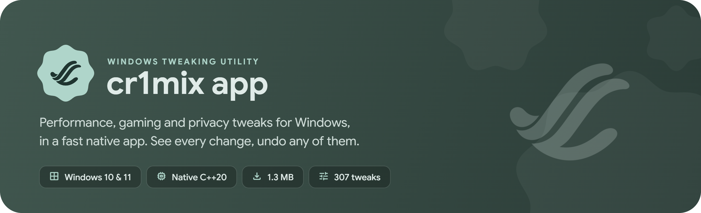

<br>

<a href="../../releases/latest"></a>&nbsp;&nbsp;<a href="https://cr1mix.pages.dev"></a>&nbsp;&nbsp;<a href="https://discord.com/invite/NjkgT7vXBb"></a>

<br><br>

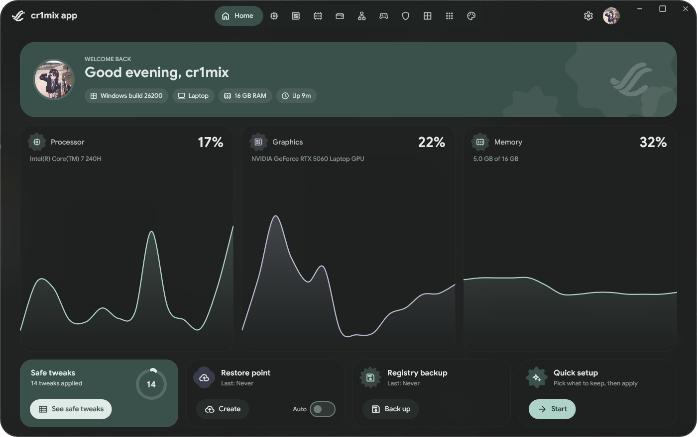

<sub>Live processor, graphics and memory graphs, with restore point, registry backup and Quick setup one click away.</sub>

</div>

<br>

cr1mix app is a free and open source Windows tweaking utility built from scratch in C++20. It ships as a single 1.3 MB executable with no runtime and no background service.

Every tweak is written by hand, says what it does in plain words, and can be switched back. Nothing changes until you choose it.

<br>

## Features

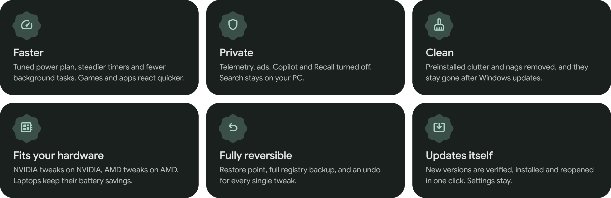

<br>

## A closer look

### Safe tweaks

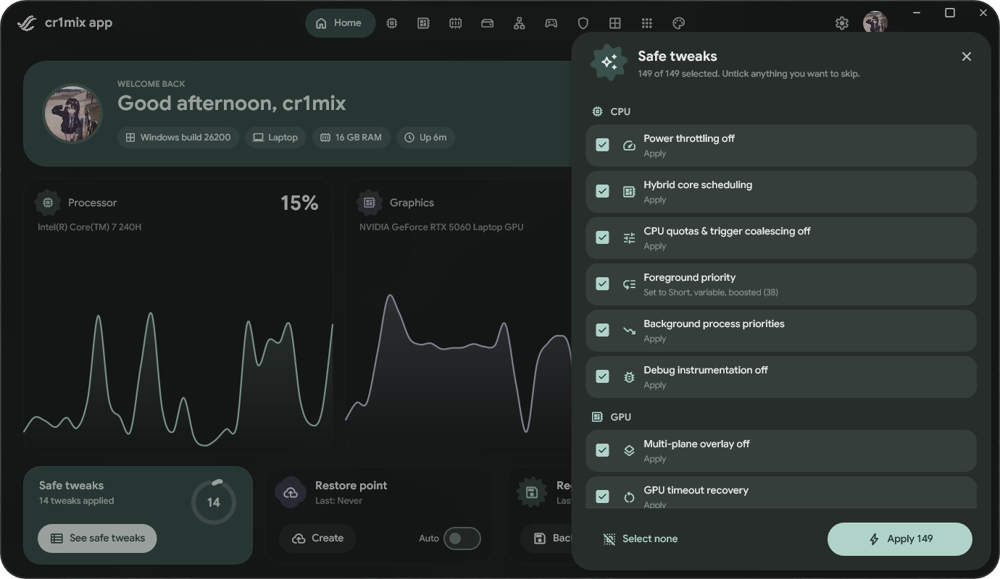

Safe tweaks open as a checklist, grouped by category. Read what each one does, untick what you want to keep, then apply the rest in one go.

<br>

### Quick setup

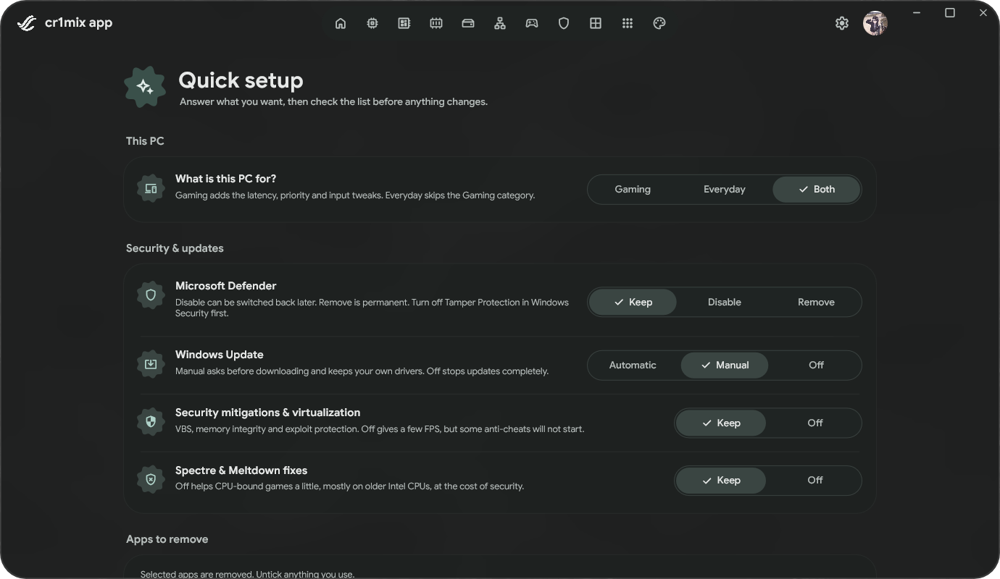

A fresh Windows in minutes. Quick setup asks about Defender, updates, apps, AI, looks, power, services and privacy, then builds the whole plan for you and shows it before anything changes.

<br>

### CPU

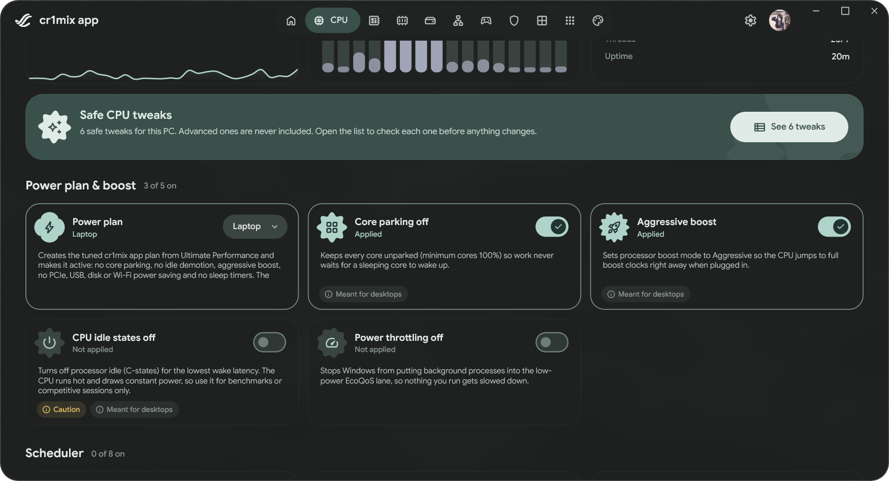

A power plan built from Ultimate Performance, with a laptop profile that keeps battery savings. Timer resolution, foreground priority, core parking and power throttling, each explained on its own card.

<br>

### GPU

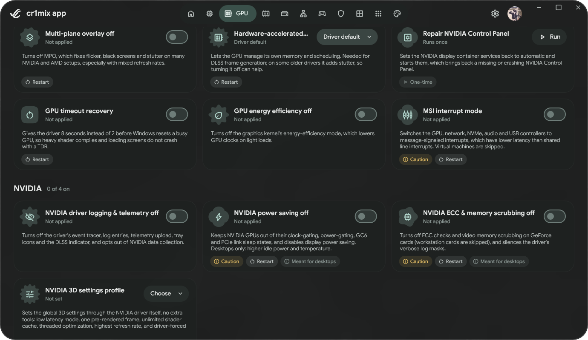

The NVIDIA 3D profile is set through the driver itself, with no extra tools. Multi-plane overlay, GPU scheduling and interrupts are one tap each, and only the tweaks for your card show up.

<br>

### Services and apps

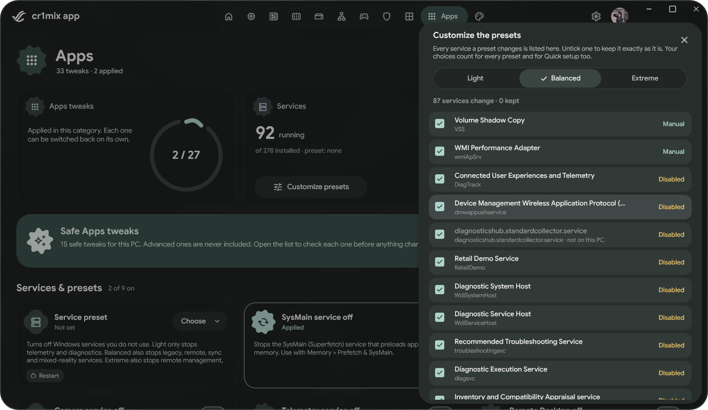

Service presets go from Light to Extreme, and you keep any service you still use. Remove the apps you never asked for, turn off Copilot and Recall, and install a browser in one go.

<br>

## Tweaks

307 tweaks across 10 categories, each one explained on its own card.

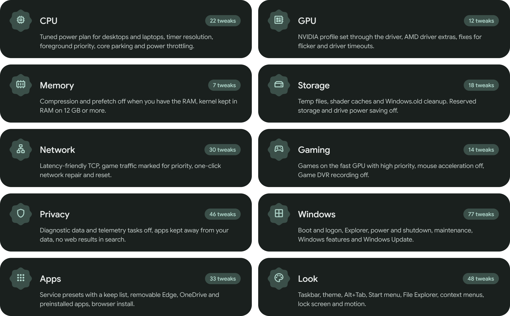

<br>

## Safety

Everything cr1mix app changes can be undone.

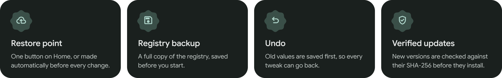

<br>

## Getting started

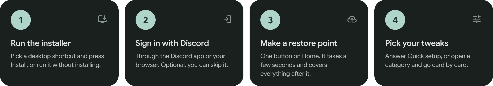

<br>


<br>


<br>

## Building from source

Requires [llvm-mingw](https://github.com/mstorsjo/llvm-mingw) `20261104` (ucrt, x86_64), extracted to `.tools\llvm-mingw-20261104-ucrt-x86_64`.

```powershell
powershell -ExecutionPolicy Bypass -File build.ps1
```

The build writes `build\cr1mix.exe` and `build\cr1mix app setup.exe`.

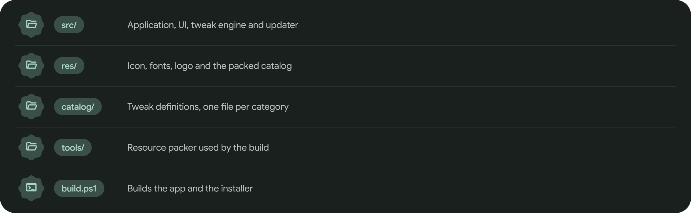

<br>

<div align="center">
<sub>Open source under the <a href="LICENSE">GPL-3.0 license</a>. © 2026 cr1mix.</sub>
</div>
